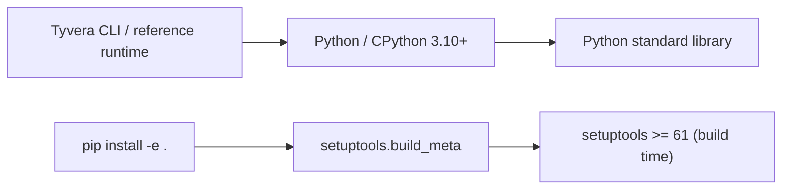

# Tyvera

[](#core-language-bootstrap)
[](https://github.com/Reina-Kousaka1/Tyvera/actions/workflows/ci.yml)
[](LICENSE)
[](pyproject.toml)

Tyvera is an independent, statically typed programming language with a design direction informed by Java's structure, Elixir's resilient concurrency model, and C++'s performance and system-level capabilities. It is not an extension or fork of those languages. TypeScript is not part of the current Tyvera design.

## Core language bootstrap

The repository contains a working bootstrap toolchain: a lexer, parser and AST,
static type checker, source-located diagnostics, and interpreter. Python/CPython
hosts the bootstrap toolchain and current reference implementation for Tyvera
semantics; Tyvera source is not compiled to Python, and Python is not part of
the long-term language contract. The present toolchain requires Python 3.10 or
newer. Native executables that run without Python remain a planned goal, and no
native backend exists yet.

The implemented language includes `Int`, `Float`, `Bool`, `String`, `Void`,
interface-constrained generic functions, classes, records, enums and newtypes, transparent type
aliases, typed tuples, `List<T>` and `Map<K,V>`, `Option<T>` and `Result<T,E>`,
nested statement-level pattern matching, checked equality and map keyability,
`for`, checked text I/O and path helpers, move-only `TextFile`, `TextReader`, and
`TextWriter` resources with explicit ownership transfer and deterministic cleanup,
secrets, typed JSON, checked returns, lexical scopes, arithmetic, comparisons,
conditionals, and loops. Classes, interfaces, and
multi-file projects support checked initialization, dynamic dispatch, relative
imports, and `pub` exports.

The reference runtime also provides asynchronous text-file operations,
non-blocking TCP connect/listen/accept/read/write, DNS lookup, portable
IPv4/IPv6 address values, and move-only connection/listener resources. An
experimental HTTP/1.1 codec, bounded concurrent server, static router, and
typed HTTP client build on those same TCP tasks and resource rules. See
[`examples/tcp_echo.tyv`](examples/tcp_echo.tyv) and
[`examples/http_server.tyv`](examples/http_server.tyv) for local examples.
TLS, WebSockets, and native code generation remain planned.

The deterministic actor runtime supports typed messages, isolated state, FIFO
mailboxes, crash isolation, bounded `one_for_one` supervision, request/reply,
cancellation, and delayed delivery. The cooperative task runtime supports
`async fn`, typed `await`, `TaskGroup`, child detachment, timeouts, cancellation
and explicit joins. Runtime shutdown, detached task failures, and fairness for
tasks waiting on actor replies are specified and tested. `Unit`, `and`, and
`or` remain compatibility spellings.

Bootstrap requirements: Python 3.10 or newer. The toolchain has no third-party runtime dependencies.

## Dependency graphs

### Package dependencies

The runtime uses Python's standard library and declares no third-party runtime
packages. `setuptools` is required only to build/install the bootstrap package.



### Compiler and execution path

```mermaid
flowchart LR
    source["Tyvera .tyv source"] --> frontend["Lexer, parser and AST"]
    frontend --> modules["Module linking"]
    modules --> checker["Type checking and semantic analysis"]
    checker --> checked["CheckedProgram"]
    checked --> boundary["ExecutionBackend"]
    boundary --> reference["ReferenceInterpreterBackend"]
    reference --> runtime["Tyvera reference runtime"]
    runtime --> python["Python / CPython host"]
```



The native backend is not implemented; `ExecutionBackend` currently selects
the reference interpreter.

Tyvera is licensed under **GNU GPLv3**; see [LICENSE](LICENSE).

```sh
python -m pip install -e .
tyvera run hello.tyv
```

Expected output:

```text
Hello from Tyvera!
```

## Projects and modules

Tyvera supports small multi-file projects. `tyvera new my_app` creates a
`tyvera.toml` manifest and two `.tyv` modules. `tyvera check` and `tyvera run`
accept a project directory or source file. Imports use explicit relative paths
and aliases; only `pub` declarations are visible across modules:

```tyv
import "models/user.tyv" as models

fn main() {
    let user: models.User = models.User("Charlotte")
    println(user.name)
}
```

The loader checks public visibility, missing files/symbols, duplicate names,
cyclic imports and project-root boundaries. `.tyvera.secrets` is gitignored;
`secrets.NAME` reads it before falling back to the process environment.

```sh
tyvera new my_app
tyvera check my_app
tyvera run my_app
tyvera --version
```

Check a program without running it:

```sh
tyvera check hello.tyv
tyvera check examples/score.tyv
tyvera run examples/score.tyv
tyvera check examples/user.tyv
tyvera run examples/user.tyv
tyvera check examples/collections.tyv
tyvera run examples/collections.tyv
tyvera check examples/tcp_echo.tyv
tyvera run examples/tcp_echo.tyv
tyvera check examples/http_server.tyv
tyvera run examples/http_server.tyv
tyvera check examples/json.tyv
tyvera run examples/json.tyv
tyvera check examples/actors.tyv
tyvera run examples/actors.tyv
tyvera check examples/supervision.tyv
tyvera run examples/supervision.tyv
tyvera check examples/runtime_foundations.tyv
tyvera run examples/runtime_foundations.tyv
tyvera check examples/async_tasks.tyv
tyvera run examples/async_tasks.tyv
tyvera check examples/type_system_v2.tyv
tyvera run examples/type_system_v2.tyv
tyvera check examples/resource_scopes.tyv
tyvera run examples/resource_scopes.tyv
```

Run the test suite from the repository root:

```sh
python -m unittest discover -v
```

See [CONTRIBUTING.md](CONTRIBUTING.md) for local checks and the pull-request
workflow. The [issue chooser](https://github.com/Reina-Kousaka1/Tyvera/issues/new/choose)
routes bug, feature, language-proposal, documentation, and development-question
reports. Also see the [support guide](SUPPORT.md), [Code of Conduct](CODE_OF_CONDUCT.md),
[security policy](SECURITY.md), and [changelog](CHANGELOG.md).

The detailed grammar and type rules are in the [language reference](docs/language.md).
Current and planned library APIs are in the [standard library reference](docs/standard-library.md).
CLI commands are listed in the [CLI reference](docs/cli.md). Architecture decisions
are in the [architecture note](docs/architecture.md), and planned stages are in
the [roadmap](docs/roadmap.md).

The implemented scheduler lifecycle is specified in [Runtime semantics](docs/runtime.md).
The value and resource rules are in the [Memory Model](docs/memory-model.md).
The backend boundary, runtime contract, target plan, and native compiler options
are in [Backend Architecture](docs/backend-architecture.md).

## Direction

The object-system slice, multi-file modules, generics, collections, optional
and result values, pattern matching, text I/O, local/environment-backed
secrets, typed JSON, deterministic actor supervision, one-shot actor replies,
and a cooperative task scheduler with nested `await`, scoped cancellation,
implicit child joining, owner-local task groups, explicit child detachment,
and task deadlines are implemented. Async text-file I/O, DNS, and TCP V1 are
implemented. HTTP/1.1 V1 is implemented as an experimental codec, client,
bounded server, and static router. True parallel execution, TLS, WebSockets, separate
standard-library modules, external secret stores, and native backends remain
planned. See the
[roadmap](docs/roadmap.md) for sequence and
scope, and [release/versioning notes](docs/release-process.md) for the
pre-1.0 release approach.

